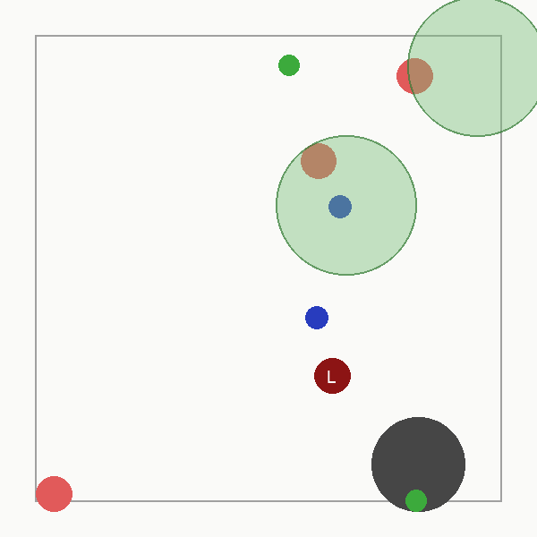
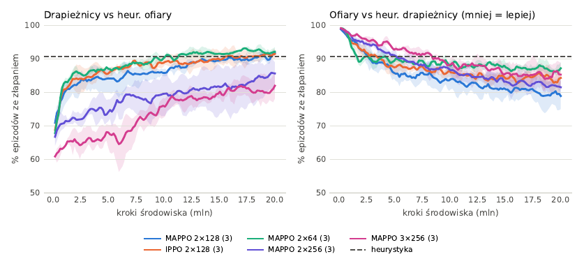
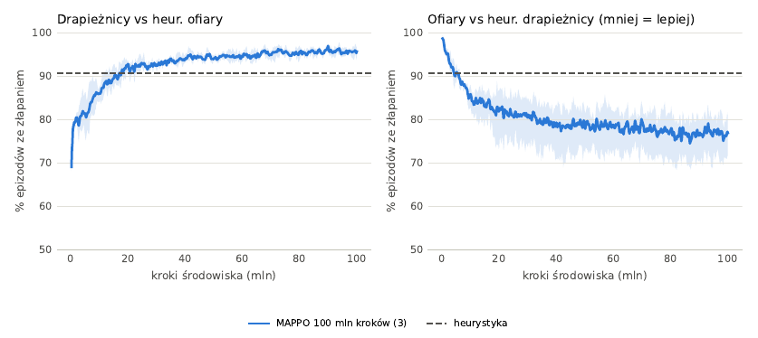
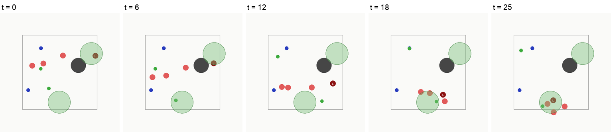

# MPE2 Simple World Comm: RL course project (2026Z)

Jerzy Czarnecki, Mateusz Małachowski

Environment: [`simple_world_comm_v3`](https://mpe2.farama.org/) from MPE2 (PettingZoo API). It has 4 predators, including a leader that can send messages, and 2 faster prey, plus food, forests and an obstacle. Both teams are trained at the same time (self-play) with our own MAPPO implementation.



## Setup

```bash
uv sync
```

## Project structure

```
worldcomm/                 # library code
├── env.py                 #   make_env(), role helpers, leader action decoding (move = a % 5, message = a // 5)
├── metrics.py             #   EpisodeStats: team rewards, catches, food / out-of-arena / forest time, message entropy
├── policies.py            #   random and heuristic team policies, make_policy("random" | "heuristic" | "mappo:<ckpt>")
├── render.py              #   fixed-camera renderer (the built-in one rescales and hides agents under forests)
├── plotting.py            #   shared plot style
├── vec_env.py             #   envs in worker processes, running in lockstep
└── mappo.py               #   MAPPO: actor per role, critic per team (global state or own observation), value normalisation
scripts/
├── inspect_env.py         # spaces, observation layout, map figures
├── record.py              # episode video + frame strip for any pair of team policies
├── train_mappo.py         # training (self-play or one team against a fixed opponent)
├── sweep.sh               # several configs x seeds, a few runs in parallel
├── plot_training.py       # learning curves of single runs
├── compare_runs.py        # configs over seeds: table (mean ± std) and learning curves
├── eval_baselines.py      # random / heuristic / MAPPO matchups, 1000 episodes each, on layouts unseen in training
├── eval_length.py         # agents trained on 25-step episodes evaluated on 25 / 50 / 100 steps
└── eval_env_settings.py   # agents trained on other environment settings (number of forests, episode length)
presentation/
├── slides.tex             # checkpoint 1
├── checkpoint2.tex        # checkpoint 2
├── figures/, media/       # plots, frame strips, videos
└── generated/             # LaTeX tables written by the scripts
docs/figures/              # figures used in this README
```

Not in the repository: `runs/<name>/` (training: `progress.csv`, checkpoints, `final.pt`) and `results/` (per-episode CSV logs of every evaluation). Both are recreated by the scripts below.

## Results (checkpoint 2)

Learning curves of the compared configurations (20M steps, 3 seeds, band = min to max):



Best configuration (MAPPO 2×128) trained for 100M steps:



MAPPO predators and prey in action:



The full results and tables are in `presentation/checkpoint2.pdf`.

## Reproduce

```bash
uv run python scripts/inspect_env.py
uv run python scripts/record.py --adv random --good random
uv run python scripts/eval_baselines.py                     # random / heuristic baselines

# configuration comparison: MAPPO vs IPPO and network sizes, 3 seeds x 20M steps
caffeinate -i bash scripts/sweep.sh
uv run python scripts/compare_runs.py mappo_h128 ippo_h128 mappo_h64 mappo_h256 mappo_h256x3

# best configuration, 100M steps; prey also trained against heuristic predators in 50% of iterations
CONFIGS="v2_long v2_mix" STEPS=1e8 caffeinate -i bash scripts/sweep.sh

# trained agents vs baselines, mean over 3 seeds
C0=mappo:runs/v2_long_s0/final.pt C1=mappo:runs/v2_long_s1/final.pt C2=mappo:runs/v2_long_s2/final.pt
uv run python scripts/eval_baselines.py --agents --average-seeds --extra heuristic,heuristic \
    $C0,heuristic $C1,heuristic $C2,heuristic heuristic,$C0 heuristic,$C1 heuristic,$C2 $C0,$C0 $C1,$C1 $C2,$C2
uv run python scripts/record.py --adv $C0 --good $C0 --out presentation/media/mappo_agents.mp4 --strip presentation/figures/mappo_strip.png

# other environment settings (0 / 4 forests, 50-step episodes), 2 seeds x 20M steps, 3 runs at a time
CONFIGS="env_f0 env_f4 env_ep50" SEEDS="0 1" PAR=3 WORKERS=5 caffeinate -i bash scripts/sweep.sh
uv run python scripts/eval_env_settings.py
uv run python scripts/eval_length.py runs/v2_long_s{0,1,2}/final.pt

cd presentation && tectonic checkpoint2.tex
```

## AI usage (required in the final report)

Claude (Claude Code) wrote most of the code (environment exploration, baselines, MAPPO, experiment and evaluation scripts) and drafts of the slides, following our instructions. We chose the experiments, reviewed the code and checked the results.
